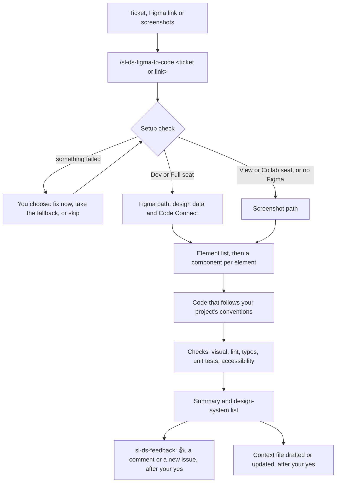

# Building UI from a Figma design with sl-ds: the agent workflow

This is for front-end developers in product teams who build screens with SL Design System (`@sl-design-system/*`) components and use an AI coding agent (GitHub Copilot in VS Code, Copilot CLI or Claude Code).

Two skills in this folder do the work in your product repository:

| Skill                 | What it does                                                                                                                                                               |
| --------------------- | -------------------------------------------------------------------------------------------------------------------------------------------------------------------------- |
| `sl-ds-figma-to-code` | Builds or changes UI from a Figma link, a Jira or GitHub ticket with designs, or screenshots. It checks your setup, picks components in a fixed order and checks the result. |
| `sl-ds-feedback`      | Sends what the first skill found (sl-ds bugs, missing features, Code Connect mappings that gave no working code) to the design-system team as GitHub issues, after your yes. |

The other skills here (`sl-ds-ticket-to-plan`, `changeset`) are for work on the design system itself, in this repository.

## The workflow at a glance



## 1. Before your first run

You need some of these, depending on what you work from:

| What                 | When                                  | How                                                                                                                                                      |
| -------------------- | ------------------------------------- | -------------------------------------------------------------------------------------------------------------------------------------------------------- |
| Figma MCP server     | Figma links, with a Dev or Full seat  | Remote server `https://mcp.figma.com/mcp`. Claude Code: `claude plugin install figma@claude-plugins-official`. Copilot CLI: `copilot plugin install figma@awesome-copilot`. VS Code: the Figma plugin for GitHub Copilot. |
| Atlassian MCP (v2)   | Jira tickets                          | `https://mcp.atlassian.com/v2/mcp`. Only v2 can download ticket attachments.                                                                              |
| `gh` or GitHub MCP   | GitHub tickets, and `sl-ds-feedback`  | Install `gh` from https://cli.github.com, then `gh auth login`.                                                                                           |
| A browser tool       | The visual check                      | VS Code's built-in browser tools, or `npm install -g @playwright/cli@latest`, or a Playwright MCP server.                                                 |
| Your app, running    | The visual check                      | The agent asks before it starts anything. Have the URL of the screen ready.                                                                               |

A View or Collab Figma seat gets 20 Figma MCP calls a month.
The skill knows this: it takes the screenshot path, asks before each Figma call and suggests "Copy as PNG" instead.

For sl-ds itself, your app needs a theme package with its `theme.css` loaded and its `setup()` called, the polyfills, and access to the GitHub npm registry to add packages.
The setup check looks for these and gives the fix; see also [Getting started for developers](../../website/src/categories/getting-started/developers.md).

## 2. Add the skills to your repository

Copy the two skill folders from this repository into yours:

```text
.github/skills/sl-ds-figma-to-code/   # with its references/ and templates/
.github/skills/sl-ds-feedback/
```

- GitHub Copilot (VS Code and CLI) reads `.github/skills/`.
- Claude Code reads `.claude/skills/`: add symlinks there, as this repository does (`ln -s ../../.github/skills/sl-ds-figma-to-code .claude/skills/`).

Commit them, so the whole team works with the same version.
To update, copy them again from `main`.

## 3. Check your setup once

```text
/sl-ds-figma-to-code check
```

This only runs the setup check: ticket access, Figma seat, Figma's skill, images, the context file, the browser tool, your lint, type-check and test commands, and the sl-ds setup (installed packages, theme, component registration).
Each line comes back as `ok`, `route`, `question`, `failed` or `n/a`.
For each failed line, the agent gives you the fix for your client, waits, and checks again.
It never takes a fallback on its own.

## 4. Build from a design

```text
/sl-ds-figma-to-code ABC-123
/sl-ds-figma-to-code https://www.figma.com/design/<fileKey>/<name>?node-id=1-2
```

Or just ask in your own words ("build this screen from the design in ABC-123"), and paste screenshots if you have no Figma access.

What happens, and what you are asked:

1. **Setup check.** The same checklist as above, every run. Answer the open lines one by one.
2. **Reading the design.** The agent writes down the regions and elements it will build. This list is what it checks against later, so correct it now if something is missing.
3. **A component per element**, the first that fits:
   1. The component your project already uses for this kind of element.
   2. An sl-ds component as it is.
   3. An sl-ds component adjusted through its variants, properties, slots, CSS custom properties or tokens, never its internals.
   4. Another library your project already uses, when no Stable sl-ds component fits.
   5. Custom, from your project's tokens and building blocks.

   Code Connect snippets from Figma are used only when every `sl-*` tag, attribute, slot and event in them exists in your installed version.

   You are asked before the agent adds a package or UI library, uses an sl-ds component that is not `stable`, builds something custom that sl-ds might cover, or moves away from your project's convention.
4. **Code.** It follows your repository's instructions, the context file and the nearest similar screen, and changes only what the ticket and design ask for.
   Design values become semantic sl-ds tokens (`--sl-color-background-*` and the like), never raw hex or px values or palette tokens.
   A new sl-ds component comes with its package and its `register.js` import, or in Angular its wrapper from `@sl-design-system/angular/<name>` and, for forms, its directive from `@sl-design-system/angular/forms`.
5. **Checks.** A screenshot of the changed area compared with the design, item by item. Lint, type-check and the affected unit tests. An accessibility pass: roles, names, alt text, labels, and focus order with Tab. At most two fix rounds each, then it reports what is left.
6. **Summary.** The setup check again, then per element the component chosen, where it came from and why, then what passed and what is left, and finally the list for the design system.

Review the per-element table first: it is the fastest way to catch a wrong component choice.

## 5. The context file

On the first run, the agent drafts `.github/sl-ds-figma-to-code.md` from what it learned: your stack, UI libraries and their roles, your styling convention, commands, how to reach screens locally, where screenshots go, and accepted decisions.
It writes the file only after you agree.

Commit it.
From then on, every run starts from it, and the agent proposes changes when it learns something new.
The **Accepted decisions** section matters most: list there what your team chose on purpose (for example "we keep our own data table"), so the design-system list stops repeating it.
Never put passwords or tokens in this file.

## 6. Send feedback to the design system

At the end of a run, the agent hands its design-system list to `sl-ds-feedback`.
You can also start it on its own:

```text
/sl-ds-feedback sl-button has no focus ring with fill=link
```

For each item, the skill:

1. Checks the component's status and changelog. A Stable component that already covers the need, or a fix in a newer version, means no issue is needed.
2. Searches open and closed issues.
3. Drafts a 👍 on a match, a comment if you add something new, or a new issue from the repository's issue form. The steps to reproduce use the public Storybook or a small sl-ds-only snippet.
4. Shows you everything in one list: send all, pick, edit or skip.

github.com/sl-design-system/components is a public repository, and issues go out under your GitHub name.
The skill leaves out product names, ticket keys, internal links, product code and unreleased designs.
Check the text before you say yes.

## 7. When a skill gets something wrong

At the end of a run, both skills look back once.
If the skill caused a problem, for example you had to correct a component choice it should have got right, it shows what happened and the smallest change to its own instructions, as a diff.
With your yes, that goes to the design-system team as a General issue titled `[sl-ds-figma-to-code] …` or `[sl-ds-feedback] …`, through the same search-and-confirm steps as any other feedback.
The skills never change themselves.

You can also tell the team directly: what you asked, what the skill did, and what it should have done.
The team keeps its test reports in [`.github/skill-tests/`](../skill-tests/README.md).
Remove internal names, ticket keys and links before you share anything, because the repository is public.

## Quick reference

| You want to                          | Run                                         |
| ------------------------------------ | ------------------------------------------- |
| Check your setup                     | `/sl-ds-figma-to-code check`                |
| Build from a ticket                  | `/sl-ds-figma-to-code <ticket key or link>` |
| Build from a Figma frame             | `/sl-ds-figma-to-code <Figma link>`         |
| Build from screenshots               | Paste them and ask, or run the skill        |
| Report an sl-ds bug or request       | `/sl-ds-feedback <what is wrong or missing>` |
